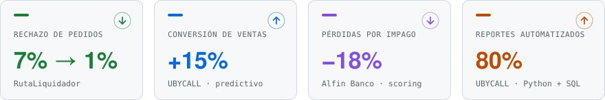
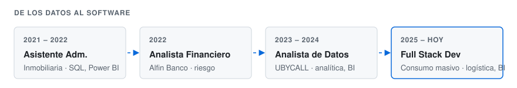

<picture>
  <source media="(prefers-color-scheme: dark)" srcset="assets/header-dark.svg">
  
</picture>

<picture>
  <source media="(prefers-color-scheme: dark)" srcset="assets/contributions-dark.svg">
  
</picture>

Construyo y opero las plataformas internas del área de Inteligencia de Negocios de una distribuidora de consumo masivo en Perú: **logística de última milla**, **fuerza de ventas** y **BI**. Backend en Python/FastAPI, frontends en React, apps móviles en React Native.
Diseño cada sistema a partir de la métrica de negocio que debe mejorar, y la mido cuando ya está en producción.

```yaml
# ~/.config/italo.yml
name: Italo Fabio Sinisi Quintana
role: Full Stack · Backend (Python, FastAPI) · Datos
location: Lima, PE  # GMT-5
experience: 5+ años en software y datos
building:
  - logística y reparto de última milla
  - fuerza de ventas
  - inteligencia de negocios
daily_stack: [Python, FastAPI, PostgreSQL, TypeScript, React, React Native, Docker]
practices: [CI/CD, contenedores, pruebas automatizadas, mutation testing]
favorite_language: Rust
exploring: [Android nativo (Kotlin)]
```

## RutaLiquidador

<sub>Plataforma de logística de última milla · en producción</sub>

Plataforma web y móvil para el reparto diario de pedidos: seguimiento de entregas, control GPS de la flota en tiempo real y cierre de cada ruta. Redujo la tasa de rechazo de pedidos **de 7% a 1%**.

<picture>
  <source media="(prefers-color-scheme: dark)" srcset="assets/architecture-dark.svg">
  
</picture>

**Un día de reparto**

1. El scheduler trae los despachos del día desde el ERP (solo lectura) y los copia a PostgreSQL.
2. El chofer carga su ruta y la app la guarda en el teléfono.
3. Confirma cada entrega con foto; si no hay señal, queda en cola y se reintenta. Salen alertas por WhatsApp.
4. El GPS en segundo plano envía las posiciones por lotes y la oficina ve la flota en el mapa.
5. El chofer cierra la ruta y se liquida; el scheduler envía los reportes y avisa de las rutas sin cerrar.

<sub>Stack: Python · FastAPI · SQLAlchemy · Alembic · PostgreSQL · SQL Server · TypeScript · React · Vite · Tailwind CSS · Leaflet (web) · React Native · Expo · MapLibre (móvil) · OSRM · Docker Compose · Nginx · GitHub Actions</sub>

## Impacto medido

<picture>
  <source media="(prefers-color-scheme: dark)" srcset="assets/impact-dark.svg">
  
</picture>

## Otros proyectos

| Proyecto | Qué hace | Stack |
|:---|:---|:---|
| **Ventory Multicanal** | Fuerza de ventas en campo: asistencia, registro de ventas y seguimiento de actividad, incluso sin conexión. | `FastAPI` `PostgreSQL` `React Native` `React` |
| **Capturas de Preventa** | Bot que envía reportes de preventa por WhatsApp de forma programada; reemplazó un proceso manual. En producción. | `Python` `FastAPI` `Playwright` `Node.js` |
| **Pulse** | Analítica de uso: muestra a la gerencia cómo se usan los sistemas internos. | `FastAPI` `PostgreSQL` `Docker` |
| **AUSPEX** | Dashboard para que los supervisores sigan el desempeño de su equipo de ventas en tiempo real. | `Google Apps Script` `Node.js` `TypeScript` |
| **TomaPedidos** <sub>en diseño</sub> | Motor de pedido sugerido: recomendará qué productos ofrecer a cada cliente según su historial de compras. | `Python` `PostgreSQL` `LightGBM` |

> [!NOTE]
> Estos sistemas pertenecen a las empresas para las que los construyo, por eso los repositorios son privados. Con gusto explico la arquitectura y el código.

## Stack

<picture>
  <source media="(prefers-color-scheme: dark)" srcset="assets/stack-dark.svg">
  
</picture>

<sub>Sectores: logística y reparto de última milla · fuerza de ventas · consumo masivo · riesgo crediticio · inteligencia de negocios</sub>

<details>
<summary><b>Trayectoria</b> — de los datos al software</summary>
<br>

<picture>
  <source media="(prefers-color-scheme: dark)" srcset="assets/journey-dark.svg">
  
</picture>

**Full Stack Developer, Inteligencia de Negocios** — Distribuidora de consumo masivo · <sub>Lima, Perú · dic 2025 – actualidad</sub>
- Diseño, desarrollo, despliegue y operación de las plataformas internas del área de BI.
- RutaLiquidador: rechazo de pedidos **de 7% a 1%** y control GPS de la flota en tiempo real.
- Apps de fuerza de ventas, reportes automáticos por WhatsApp y analítica de uso sobre el ERP.
- Introduje contenedores, pipelines de CI/CD y pruebas automatizadas en todos los proyectos.

**Analista de Datos de Call Center** — UBYCALL · <sub>cuenta de Pizza Hut Perú · feb 2023 – nov 2024</sub>
- Conversión de ventas **+15%** con análisis predictivo del comportamiento de clientes.
- **80%** de los reportes manuales automatizados con Python y SQL; dashboards gerenciales en Power BI.

**Analista Financiero** — Alfin Banco · <sub>mar 2022 – dic 2022</sub>
- Modelos de scoring de riesgo crediticio: pérdidas por impago **−18%**.
- Pipeline ETL automatizado que procesa más de **100,000 transacciones por día**.

**Asistente Administrativo (prácticas)** — Gestión Inmobiliaria Pacífico · <sub>may 2021 – mar 2022</sub>
- Reestructuré bases de datos internas con SQL y construí reportes en Power BI que redujeron el tiempo de tareas administrativas.

</details>

<details>
<summary><b>Educación y certificaciones</b></summary>
<br>

- **Ingeniería de Sistemas Computacionales** — Universidad Privada del Norte (UPN) <sub>en curso</sub>
- Microsoft Certified: Power BI Data Analyst Associate (PL-300)
- Certified ScrumMaster (CSM) — Scrum Alliance
- Certificación Genesys Cloud — Genesys
- Python y Análisis de Datos · Bases de Datos SQL · Desarrollo de APIs REST — EDTEAM
- En preparación: AWS Certified Solutions Architect – Associate

</details>

---

<p align="center">
  <sub>Abierto a colaborar · trabajo remoto · Lima, GMT-5</sub><br>
  <a href="mailto:sinisiquintanaitalo@gmail.com">Email</a> ·
  <a href="https://www.linkedin.com/in/italo-fabio-sinisi-quintana/">LinkedIn</a> ·
  <a href="https://italofabiosinisiq.github.io/-dev-holaMundo-true-/">Portafolio</a> ·
  <a href="https://wa.me/51977170609">WhatsApp</a> ·
  <a href="https://github.com/ItaloFabioSinisiQ/ItaloFabioSinisiQ/raw/main/cv/Italo-Sinisi-CV-ES.pdf">CV (PDF)</a>
  <br><br>
  <a href="https://github.com/settings/appearance"><picture><source media="(prefers-color-scheme: dark)" srcset="assets/theme-dark.svg"></picture></a>
</p>
