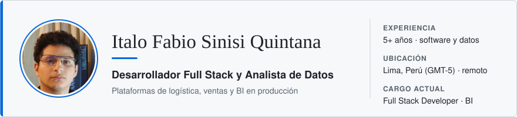
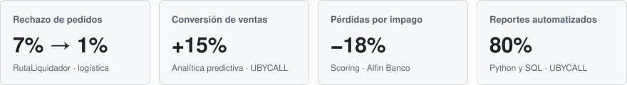
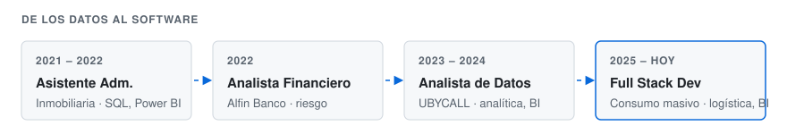

  <a href="https://github.com/settings/appearance"><picture><source media="(prefers-color-scheme: dark)" srcset="assets/theme-dark.svg"></picture></a>
  <a href="https://github.com/ItaloFabioSinisiQ/ItaloFabioSinisiQ/raw/main/cv/Italo-Sinisi-CV-ES.pdf"><picture><source media="(prefers-color-scheme: dark)" srcset="assets/cv-button-dark.svg"></picture></a>

<picture>
  <source media="(prefers-color-scheme: dark)" srcset="assets/header-dark.svg">
  
</picture>

   
  <a href="mailto:sinisiquintanaitalo@gmail.com"><b>Email</b></a> &nbsp;·&nbsp;
  <a href="https://www.linkedin.com/in/italo-fabio-sinisi-quintana/"><b>LinkedIn</b></a> &nbsp;·&nbsp;
  <a href="https://italofabiosinisiq.github.io/-dev-holaMundo-true-/"><b>Portafolio</b></a> &nbsp;·&nbsp;
  <a href="https://wa.me/51977170609"><b>WhatsApp</b></a>

## Sobre mí

Desarrollador Full Stack y Analista de Datos con más de 5 años de experiencia en software y datos. En una distribuidora de consumo masivo en Perú, diseño, construyo y opero las plataformas del área de Inteligencia de Negocios para reparto de última milla, fuerza de ventas y reportes gerenciales. Diseño cada sistema a partir de la métrica de negocio que debe mejorar, y la mido cuando ya está en producción.

**Roles:** Full Stack Engineer · Backend Engineer (Python, FastAPI) · Software Engineer · Data Engineer · BI Developer 
**Disponibilidad:** trabajo remoto a tiempo completo o por contrato, proyectos freelance y puestos presenciales en Lima · Zona horaria GMT-5 · Español nativo

<picture>
  <source media="(prefers-color-scheme: dark)" srcset="assets/approach-dark.svg">
  
</picture>

## Resultados destacados

<picture>
  <source media="(prefers-color-scheme: dark)" srcset="assets/impact-dark.svg">
  
</picture>

## Experiencia

<picture>
  <source media="(prefers-color-scheme: dark)" srcset="assets/journey-dark.svg">
  
</picture>

### Full Stack Developer, Inteligencia de Negocios — Distribuidora de consumo masivo
Lima, Perú · Diciembre 2025 – Actualidad

- Responsable del diseño, desarrollo, despliegue y operación de las plataformas internas del área de BI.
- Construí **RutaLiquidador**, la plataforma de reparto y liquidación de rutas que redujo la tasa de rechazo de pedidos **de 7% a 1%** y le dio a la oficina control GPS de la flota en tiempo real.
- Construí aplicaciones de fuerza de ventas, reportes automáticos por WhatsApp y analítica de uso sobre el ERP de la empresa.
- Introduje despliegues con contenedores, pipelines de CI/CD y pruebas automatizadas en todos los proyectos.

### Analista de Datos de Call Center — UBYCALL
Call center tercerizado, cuenta de Pizza Hut Perú · Febrero 2023 – Noviembre 2024

- Aumenté en **15%** la conversión de ventas mediante análisis predictivo del comportamiento de los clientes.
- Automaticé el **80%** de los reportes manuales con Python y SQL, y construí dashboards gerenciales en Power BI.

### Analista Financiero — Alfin Banco
Banca · Marzo 2022 – Diciembre 2022

- Desarrollé modelos de scoring de riesgo crediticio que redujeron las pérdidas por impago en **18%**.
- Construí un pipeline ETL automatizado que procesa más de **100,000 transacciones por día**.

### Asistente Administrativo (prácticas) — Gestión Inmobiliaria Pacífico
Inmobiliaria · Mayo 2021 – Marzo 2022

- Reestructuré bases de datos internas con SQL y construí reportes en Power BI que redujeron el tiempo dedicado a tareas administrativas.

## Proyecto principal: RutaLiquidador

Plataforma de logística de última milla · en producción

Plataforma web y móvil para gestionar el reparto diario de pedidos: seguimiento de las entregas, control de la flota y cierre de cada ruta. Redujo la tasa de rechazo de pedidos **de 7% a 1%**.

**Stack:** Python · FastAPI · SQLAlchemy · Alembic · PostgreSQL · SQL Server · TypeScript · React · Vite · Tailwind CSS · React Native · Expo · MapLibre · OSRM · Docker · Nginx · GitHub Actions

## Otros proyectos

| Proyecto | Descripción |
|:---|:---|
| **Ventory Multicanal** Plataforma de fuerza de ventas | Plataforma para gestionar equipos de venta en campo: asistencia, registro de ventas y seguimiento de la actividad, incluso sin conexión. <i>FastAPI · PostgreSQL · React Native · React</i> |
| **Capturas de Preventa** Bot de reportes de preventa | Automatiza el envío programado de reportes de ventas por WhatsApp y reemplazó un proceso manual. En producción. <i>Python · FastAPI · Playwright · Node.js</i> |
| **Pulse** Analítica de uso interno | Panel que muestra a la gerencia cómo se usan los sistemas internos de la empresa. <i>FastAPI · PostgreSQL · Docker</i> |
| **AUSPEX** Dashboard de supervisores de ventas | Panel para que los supervisores sigan el desempeño de su equipo de ventas en tiempo real. <i>Google Apps Script · Node.js · TypeScript</i> |
| **TomaPedidos** Motor de pedido sugerido · en diseño | Sistema que recomendará qué productos ofrecer a cada cliente a partir de su historial de compras. <i>Python · PostgreSQL · LightGBM</i> |

Estos sistemas pertenecen a las empresas para las que los construyo, por eso los repositorios son privados. Con gusto explico la arquitectura y el código en una entrevista.

## Habilidades

| Área | Tecnologías |
|:---|:---|
| Backend | Python, FastAPI, SQLAlchemy, Alembic, Pydantic, APScheduler, Node.js, Express, Prisma, APIs REST, JWT |
| Frontend | TypeScript, React, Next.js, Vite, Tailwind CSS, Leaflet, MapLibre, Recharts, ECharts |
| Móvil | React Native, Expo, sincronización offline-first, almacenamiento local cifrado, GPS en segundo plano |
| Datos y BI | PostgreSQL, SQL Server, SQLite, pipelines ETL, integración con ERP, Pandas, scikit-learn, Power BI (DAX) |
| DevOps y calidad | Docker, Docker Compose, Nginx, Linux, GitHub Actions, pytest, Jest, Vitest, Playwright, mutation testing |
| Lenguajes | Python, TypeScript, JavaScript, SQL, Rust |
| Sectores | Logística y reparto de última milla, fuerza de ventas, consumo masivo, riesgo crediticio, inteligencia de negocios |

## Educación y certificaciones

- **Ingeniería de Sistemas Computacionales** — Universidad Privada del Norte (UPN) en curso
- Microsoft Certified: Power BI Data Analyst Associate (PL-300)
- Certified ScrumMaster (CSM) — Scrum Alliance
- Certificación Genesys Cloud — Genesys
- Python y Análisis de Datos · Bases de Datos SQL · Desarrollo de APIs REST — EDTEAM

Actualmente me preparo para la certificación AWS Certified Solutions Architect – Associate.

---

  Abierto a nuevas oportunidades. La forma más rápida de contactarme es por <a href="mailto:sinisiquintanaitalo@gmail.com">correo</a>, o <a href="https://github.com/ItaloFabioSinisiQ/ItaloFabioSinisiQ/raw/main/cv/Italo-Sinisi-CV-ES.pdf">descarga mi CV</a>.

